[▶ Watch the trip video on YouTube](https://www.youtube.com/watch?v=4d4rxxO_W88)

## Day 0
_Date: April 21, 2017 at 10:53:04 PM EDT_

_Weather: 55°F Cloudy_

_Location: Philadelphia International Airport, Tinicum Township, PA, United States_

### Introduction
Long long ago, one day we (Kevin, Sreevin and I) decided to go on an unplanned trip to Hyderabad. And so unplanned it was! Even though the vivid memories of that trip had faded away from my mind, I can still turn the pages back and read about the whole journey thanks to the travelogue I had written about that trip.

PG happened to read that blog post one day. He sent me a message on the office Skype asking me to write a travelogue about the upcoming trip. Thathasthu(so be it)! I replied.

It's 10:56 PM. I'm sitting at the Philadelphia International Airport waiting for our flight. Our Spirit Airlines flight( also known as the Auto-rickshaw among flights) is behind schedule by 3 hours. You might be wondering where I'm heading and who I'm traveling with.

First things first. It will be a 3-day trip, and I am flying to Vegas.

Well, well! I know that look of envy in your eyes. You assume that my next three days will be all about drinks, party, and gambling. You can't be further wrong.

Even though we are flying in and out of Vegas, we'll be spending most of our time in the famous National Parks around LV. Still, pretty cool, right?

The itinerary goes like this:

Day 1: Death Valley National Park,

Day 2: Bryce Canyon National Park, Zion National Park,

Day 3: Zion National Park, Valley of Fire State Park and Las Vegas.

I know!

Quite a lot of places to cover, and we're beginning with a delayed flight. Regardless of what, I have a feeling, that it is going to be super fun!

Now, let me introduce my partners-in-crime.

1. Arun Koshy aka The Tree Man (who's also my current roommate )
2. PG ( who also answers to the name Anup Puthuveedu Gopalakrishnan) aka Mr. Vertigo
3. Nikhil Krishnan alias Shambhu Annan aka The Hobo (The Hobo also happens to be the name of Koshy's photography blog([link](https://www.facebook.com/senorsuperhobo/)). But in this context, the meaning better suits Shambhu Annan. Sorry, I digress)
4. Abdu aka The Hungry Hog
5. And myself, The HeadMaster.

Abdu, Hobo, and PG used to be teammates and roommates at UST Global. But Abdu left the company last year and moved to California. He will be flying in from California to join us in Las Vegas.

Also, In our story, PG was supposed to be called the Tree Man (because of his not-so-secret infatuation to Trees). Yet, Koshy is called the Tree Man and PG is not. Why? You'll find out soon.

As I'm writing, Arun is talking to his wife, PG is reading a movie review, and Shambu Annan seems to be browsing some troll pics on facebook. Abdu's Vegas flight will land within a few minutes. He will probably sit at the airport(for 6 hours) until our flight arrives.

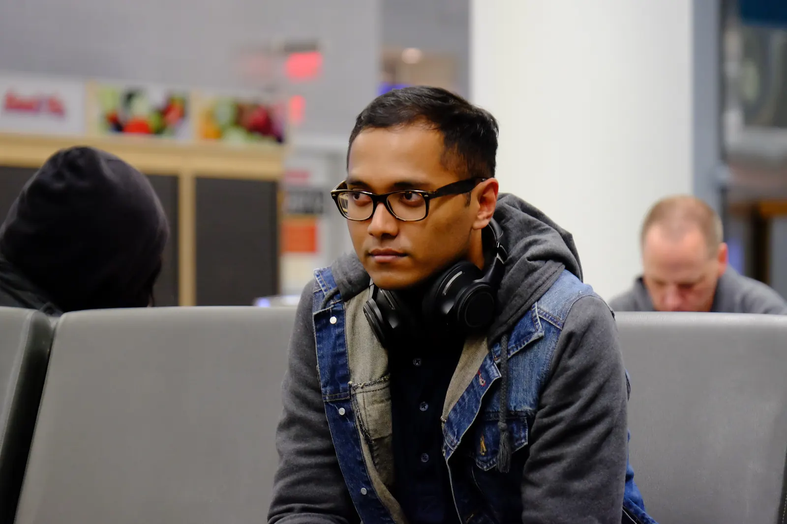

*Hour two of the three-hour delay at PHL. Headphones on, patience off.*

 

_Date: April 22, 2017 at 12:16:37 AM EDT_

 

_Location: 39.8744° N, 75.2498° W (Philadelphia International Airport)_

Boarded the flight, waiting for take-off.

Thankfully, No more surprises here. The Spirit Airlines flight journey does not come with the bells and whistles that the other airlines have to offer. You won't get good legroom, no snacks or beverages, no lumbar or neck support. But they do provide something that's so hard to beat. Dirt cheap flights. And that is all that we care for.

Koshy, PG and I got adjacent seats. A distressed and frustrated Shambhu Annan is sitting on the other side of the aisle next to an old African-American couple.

2:40 AM: I woke up mid-flight and felt thirsty. Asked for a glass of water. The air hostess was very glad to hand me a small bottle of water and charge me $3 for it! Absurd! (remember that Spirit Airlines cheap thingy I told you about?)

## Day 1
_Date: April 22, 2017 at 5:27:58 AM EDT_

### Landing in Vegas
Had an overall comfortable flight journey. I slept through most of the flight. The flight was slightly uncomfortable because of the seating. We can neither stretch our feet nor is there any neck support. But hey! Spirit is one of the cheapest flights. You really can't complain. The hard part is that you've to pay for everything on board. I asked for water, was given a 500ml water bottle and a $3 check. I guess I told you all this, right?

Anyway, I now wonder when they're gonna start asking people to pay to use the lavatories. Oops! I don't want to give Spirit Airlines management another "cost-savings" business idea.

_Date: April 22, 2017 at 3:45:14 AM PDT_

_Weather: 64°F Mostly Clear_

_Location: McCarran International Airport, Las Vegas, NV, United States_

### Heading over to Avis Care Rental
Located Abdu as soon as we landed. The LAS Airport lets you know right away why you should be visiting Vegas. Slot Machines in every nook and corner. Sorry Vegas, I'm not here to do that. We got our checked bag, freshened up and boarded the shuttle to the rental car company.

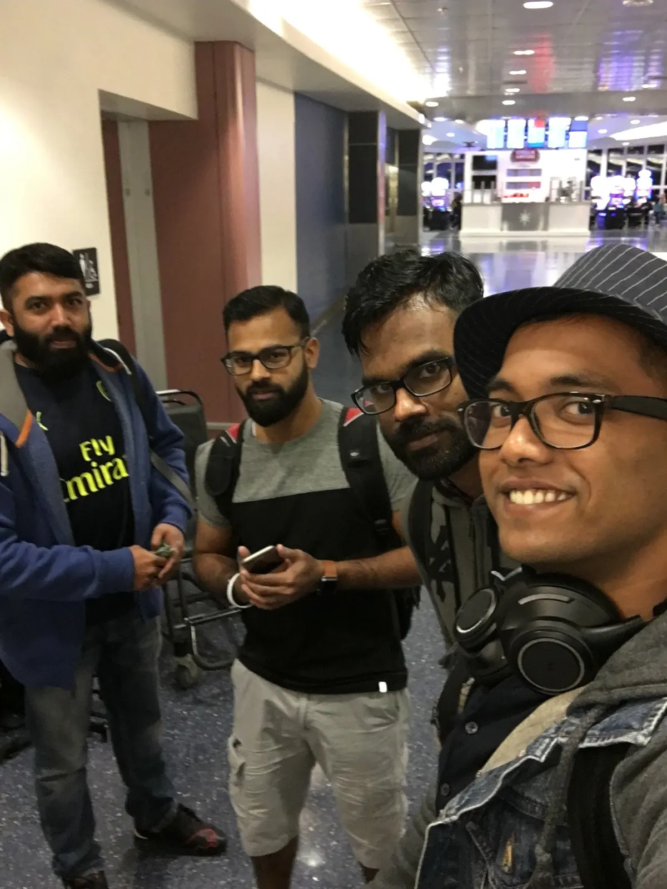

*Touchdown in Vegas around 3 AM. Abdu located. Sleep not.*

_Date: April 22, 2017 at 5:46:42 AM PDT_

_Weather: 63°F Mostly Cloudy_

_Location: 4544–4598 Blue Diamond Rd, Las Vegas, NV, United States_

### Driving
After a lot of confusion and back and forth communication, we are finally, on the road. The rental company apparently didn't have the model of the car we had booked. They, however, offered a different make and model of the same class, which we were not interested in. Finally, Abdu and I walked over to the parking lot, located a Chrysler Pacifica and demanded that we get that car instead. We got the car and paid $240 for insurance(which actually cost more than the car rental price). And yes, on the road now.

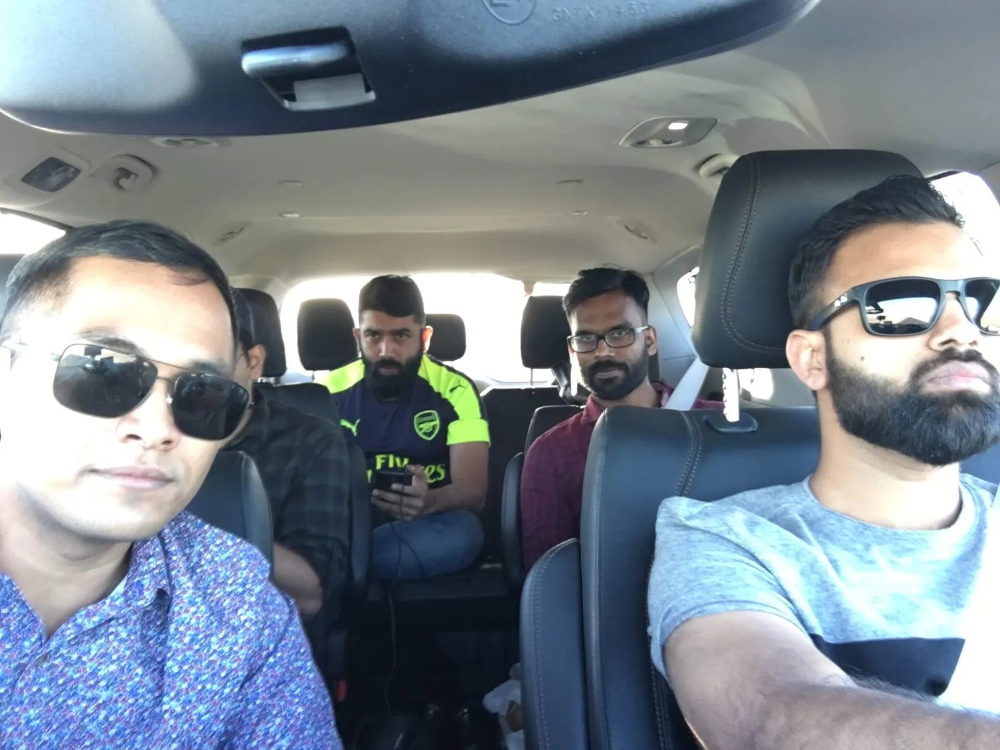

*Five men, one Chrysler Pacifica we fought for.*

Stopped at 7 Eleven and then Walmart to get some snacks and beverages for the day. Long day ahead.

_Date: April 22, 2017 at 6:17:08 AM PDT_

_Weather: 59°F Clear_

_Location: 30400–30402 State Highway 160, Las Vegas, NV, United States_

### Passing Red Rock Canyon
The car is moving along a long and deserted highway surrounded by majestic mountains basking in fresh rays of sunrise.

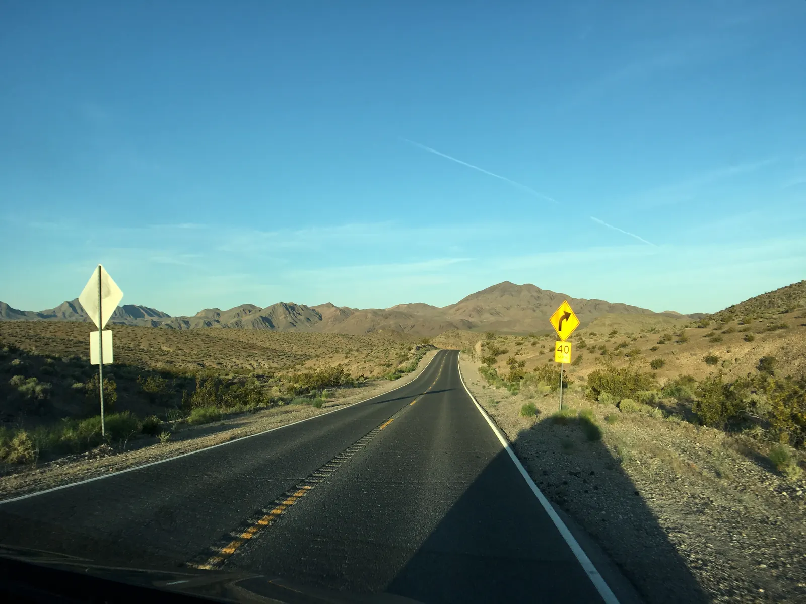

*Past Red Rock Canyon, 6:43 AM, and the speedometer already had opinions.*

Being the commander in chief for the trip, I have to keep tabs on the schedule. I had created a detailed travel plan which tells us where we have to be at what time and how long we can spend there. It was not an easy task. Weeks of research went into it. I have to factor in the weather, the time of the day, crowd prediction, and also other miscellaneous factors that can impact the trip. I had done a similar plan for my Yosemite and Smoky Mountain Trip. So, I guess I'm getting better at this.

I just looked at the itinerary to realize that we are behind schedule by 1.5 hours. Koshy is driving, and the speedometer is already clocking above 100mph.

_Date: April 22, 2017 at 6:43:50 AM PDT_

_Location: 36.2854° N, 116.165° W_

### How the scenic beauty of nature affects the traveler
If there is one thing that I can forever keep doing without ever getting tired, it would be travel. But I guess that is the case for most people. I love walking too (and many of my friends hate me for how much I make them walk. We'll wait and see what this crew has to say about it).

Perhaps the best thing about traveling is that it makes us connect with the larger part of the world where we belong. It introduces us to various cultures, different landscapes, distinctive weather patterns and so on. Moreover, the sheer magnanimity and magnificence of nature force us to look deep into ourselves and realize how small we actually are. The beauty of nature that we see around us would not have been the same without the changes it had to undergo over millions of years. Water, wind, earthquakes and other natural forged the beautiful valleys, mountains, and lakes that we have today. It is us, humans who always find it difficult to accept change. What I am trying to say is that we can learn many things about life just by observing the world around us and travel gives us opportunities to do so.

_Date: April 22, 2017 at 8:52:36 AM PDT_

_Location: 36.3546° N, 116.708° W_

### And we are on
First stop was at Zabriskie's point. A beautiful scenic overlook right on the side of the highway. A short walk to the top and we were greeted by some unique natural architectural formations.

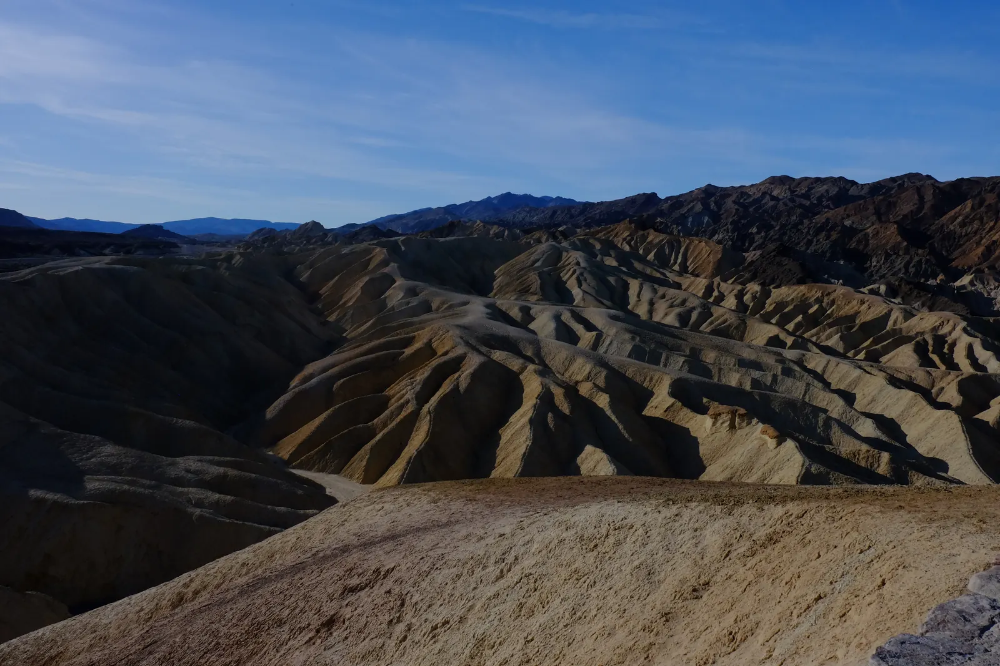

*Zabriskie Point at sunrise: the hills look like a brown blanket someone forgot to iron.*

We spent some time taking pictures and doing weird poses. On the other side of the overlook, we got a glimpse of Badwater basin.(where we would be visiting later today)

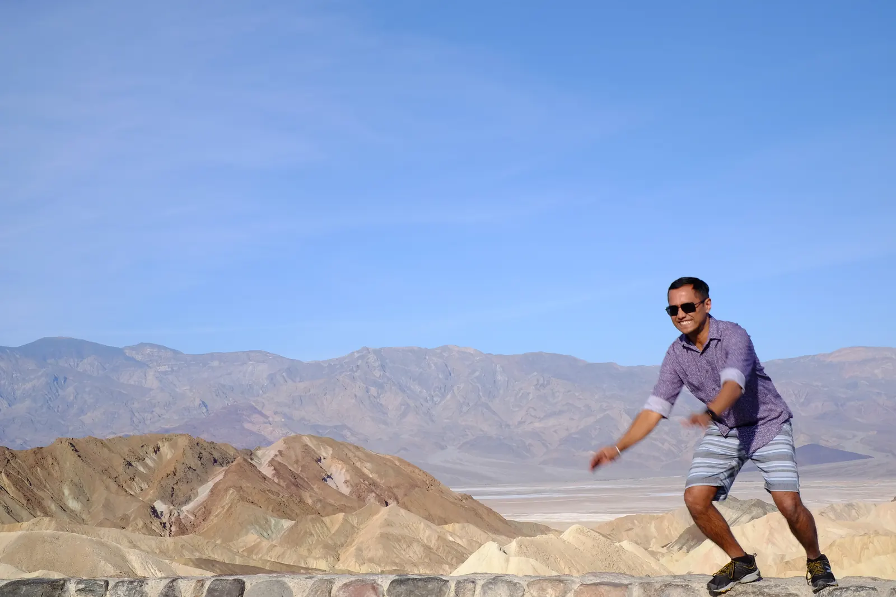

*Pulling off a Baahubali. Evidence.*

 

 

All of a sudden I could feel everyone's mood changing. The lethargy of the flight journey and long drive was finally wearing off, and we look forward to a fabulous day ahead.

Next destination was the Twenty Mule Team Road. Oh, I am so happy to have read about this place online. It is so desolate - not a plant in site and the topography is beautiful shades of white, beige, brown and red. We truly felt like this is what the planet Mars is like. An exhilarating scenic drive. This place is hidden from the usual traffic of the highway. There is no signboard marking the entrance. It's a one-way drive, and there is a rustic old sign that just says "entrance."

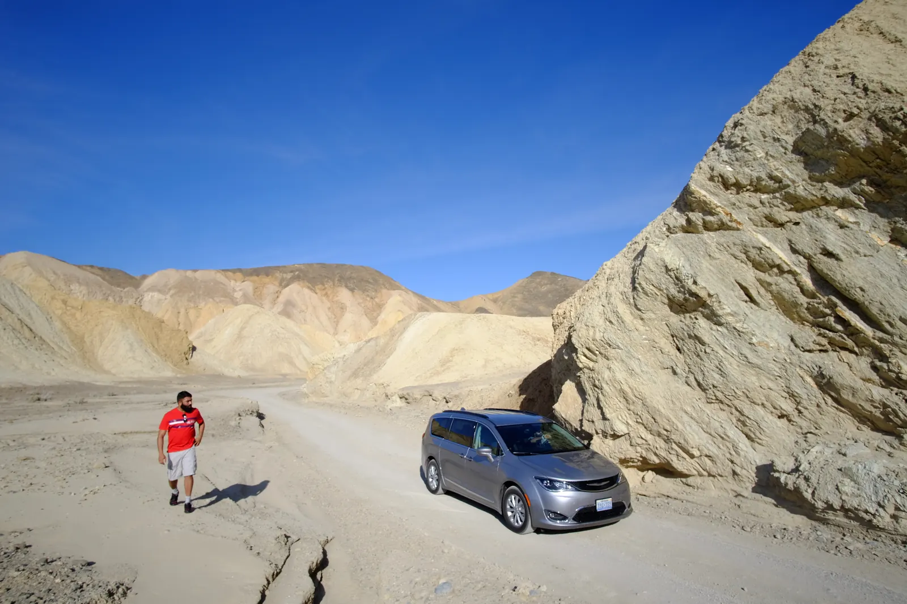

*Twenty Mule Team Canyon, with a rented Pacifica for scale. Mars, but with parking.*

But man oh man.. the views are to die for.

We stopped in between for some pictures. And continued driving.

_Date: April 22, 2017 at 9:56:18 AM PDT_

_Location: 36.243° N, 116.685° W_

### Dante's View
This might be one of the best views I've seen in my life.

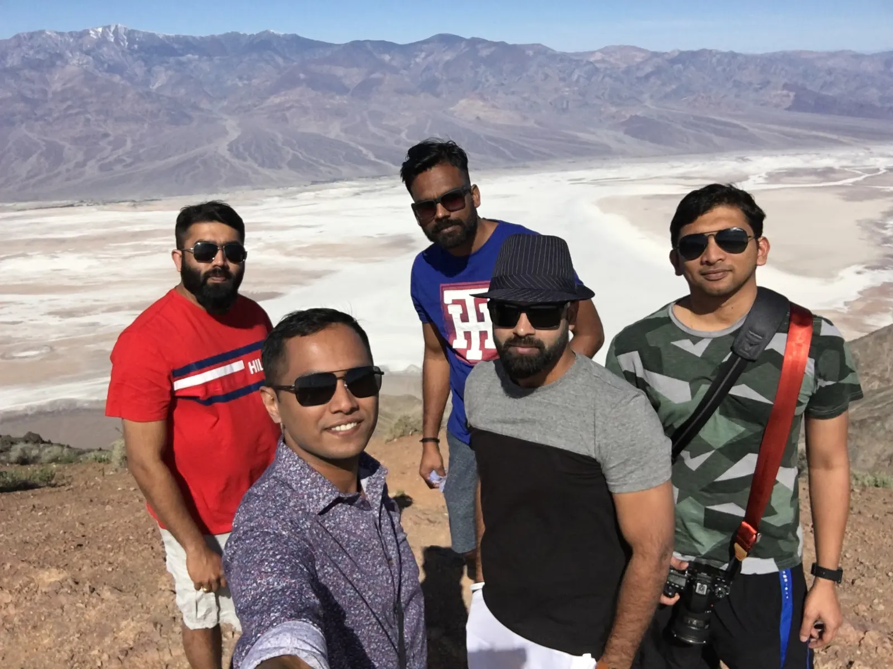

*The wolf pack at Dante's View. Badwater is the white patch behind us.*

The drive up to the overlook is packed with scenic beauty. Little yellow flowers adorn the valley. The road takes you to the top of the overlook. As soon as I got out of the car, my heart missed a beat overlooking the view. The distant mountains form a boundary guarding the snowy white salt flats called the Badwater Basin, which is the lowest point in the USA. Death Valley is home to some of the warmest temperature zones around the world. But you won't feel a thing, as the natural beauty around you numbs your senses.

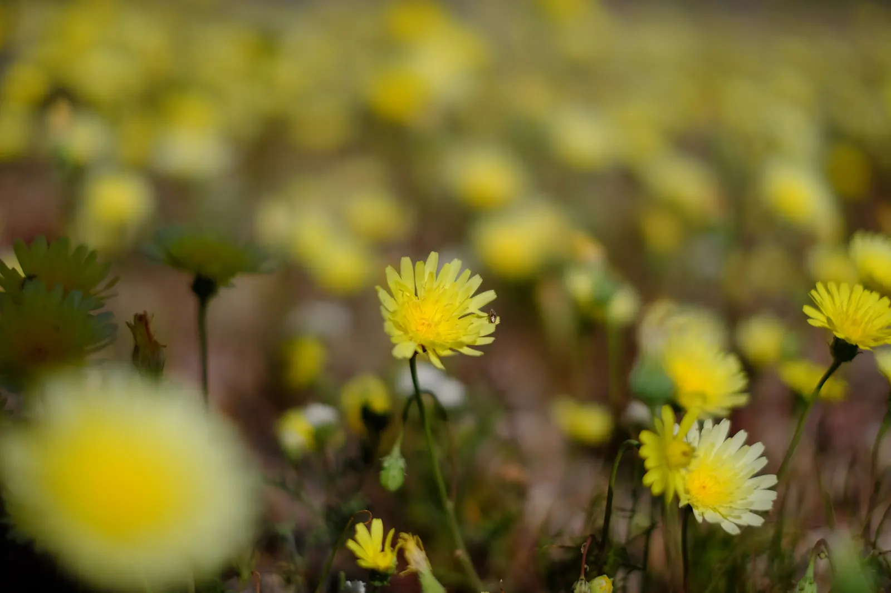

*Desert gold on the way up to Dante's View.*

Mind=Overblown!

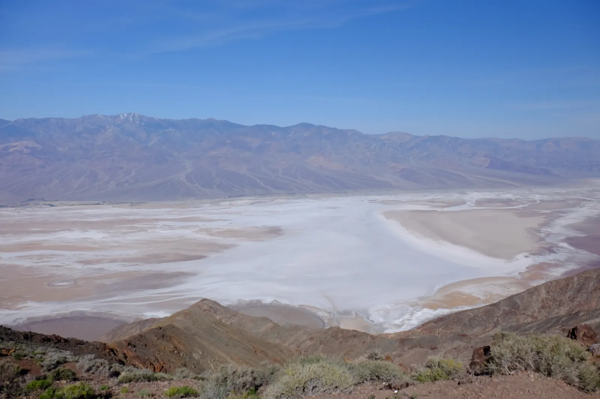

*Dante's View, with Badwater Basin looking like spilled milk.*

_Date: April 22, 2017 at 12:32:01 PM PDT_

_Location: 36.3821° N, 116.822° W_

### Bad Water Basin, Devil's Golf Course, Artist's Drive, Golden Canyon
From the majestic mountain top of Dante's view, we headed down to have a face off with the "real" death valley. Badwater basin in the lowest point in the western hemisphere. It is also one of the hottest places on earth. We walked quite far into the core of the basin. It was dry, and it was hot.

And yes, I did a headstand at the hottest and lowest point in the world.

```
#headstandaroundtheworld
```

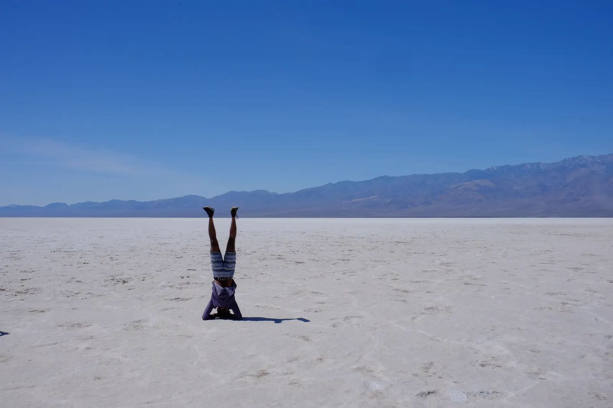

*#headstandaroundtheworld, lowest-point edition.*

Abdu and I ran back to the parking lot. We were dead tired and thirsty, but on the flipside, we reached the car a solid 10-15 mins before others. Sitting in the AC was so worth it while others were slowly walking back in the scorching sun.

Rehydrated. Ignition on, over to the next destination.

### Devil's Golf Course.
We were all too tired to get out, but Devil's Golf Course was too good not to pass on. The place got its name because the National Park Service guide book once stated that "Only the devil could play golf" on its surface, due to a rough texture from the large halite salt crystal formations.

We witnessed unique sharp crystal salt formations. I brushed my ankle against one, it tore my shoes, and I got a small cut on my ankle: so sharp it was!.

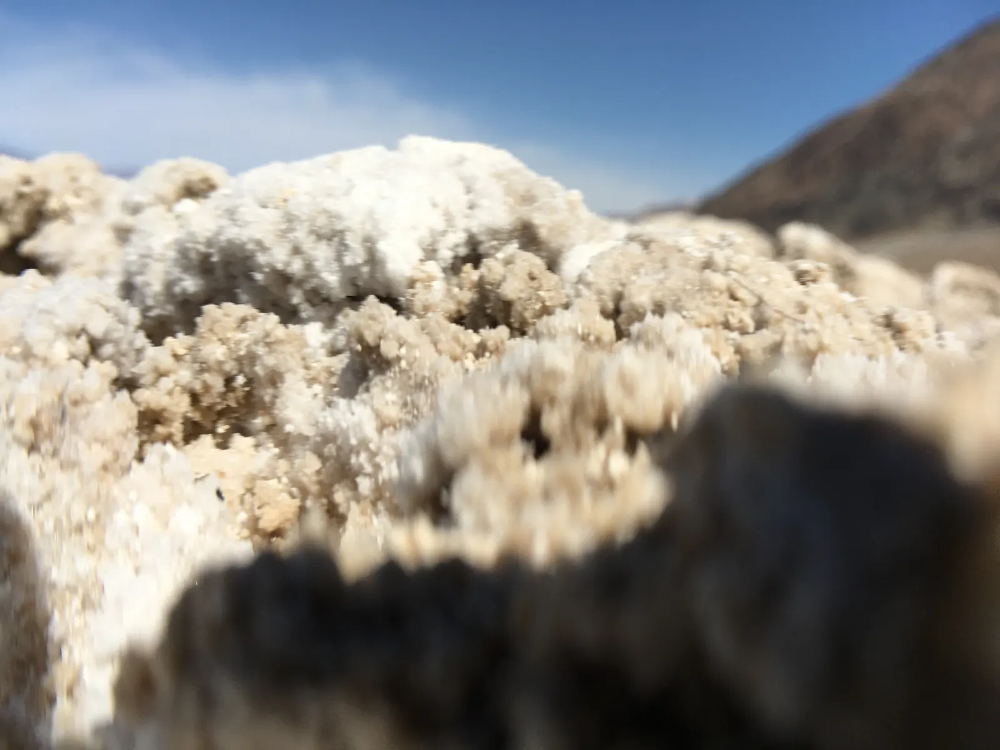

*Devil's Golf Course up close. The crystals won the argument with my shoe.*

We stayed on for another 15 minutes taking pictures and enjoying the views.

Our next destination was the Artist's Palette. Just like a color palette of an artist, the multicolored rocks decorate the valley. The information board said that these colors were formed because of the oxidation of various metals in these rocks. This would have been an unusual destination had us gone there in the morning or during the sunset. Scorching heat and overhead sun rays faded the colors of the valley, making it not that enjoyable.

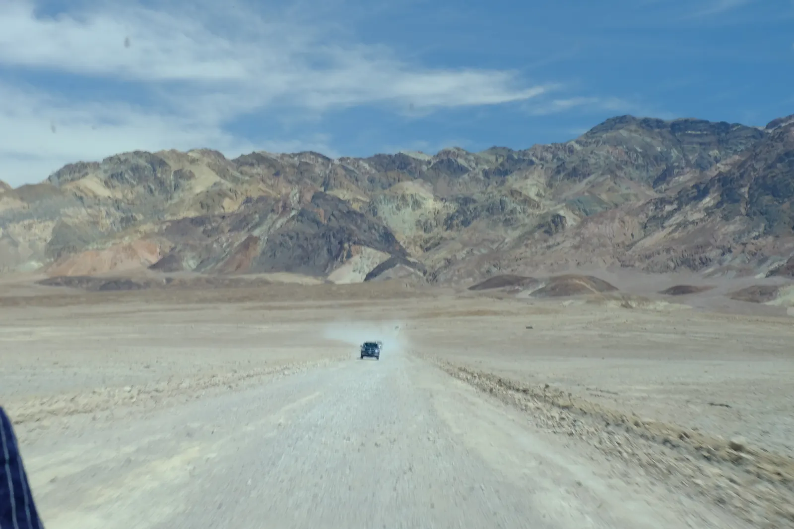

*Artist's Drive at midday: the colors were there, the sun just bleached them.*

After the Artist's Drive, we headed to Golden Canyon. Abdu didn't get out of the car. This was a 1.5-mile hike. But there was a sign board at the beginning of the hike that said "Extreme Heat. Not recommended after 10 AM." We might have walked for half-a-mile when we decided to turn back because of the heat.

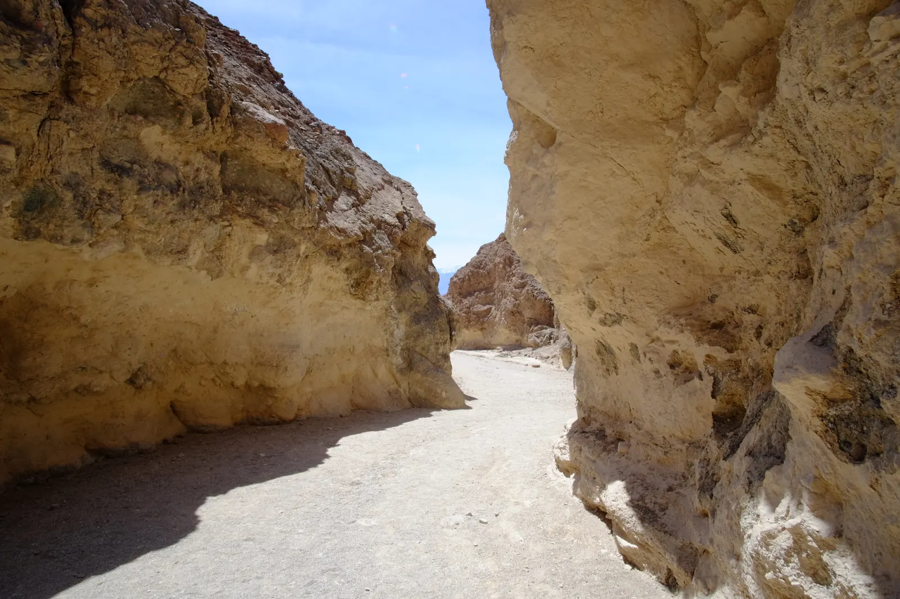

*Golden Canyon, half a mile in before the heat sent us back.*

Warnings are for duds!

 

We headed back to Furnace Creek area in search of food and gas.

_Date: April 22, 2017 at 1:30:30 PM PDT_

_Weather: 77°F Sunny_

_Location: Death Valley National Park, Death Valley, CA, United States_

### At Furnace Creek Inn for lunch
Reached Furnace Creek Inn which was built in the 1920s. We walked through an old and eerie tunnel under the restaurant and got into an elevator which took us to the third floor where the dining room was. After a brief wait, we were taken to our seats, which had a great view. We ordered coffee and food. Abdu and I ordered Fish Tacos. Shambu annan and PG ordered BLT sandwich. Koshy got an Angus Burger. Right now we are sipping the coffee and waiting for our food.

_Date: April 22, 2017 at 4:59:44 PM PDT_

_Location: Death Valley National Park, Death Valley, CA, United States_

### Mosaic Canyon
After lunch, we headed out towards Mosaic Canyon. This is the second-to-last stop of the day. The drive lasted a little less than an hour. But time passed quickly as Koshy and I were singing some Malayalam melodies throughout the drive. Food for the soul. Others slept through most of the drive.

About Mosaic Canyon. Smooth, polished marble walls enclose the trail as it follows the canyon's twisted curves. The canyon follows notches that formed when the rocky crust of the Death Valley region began stretching just a few million years ago. Running water scoured away at the fault-weakened rock, gradually carving Mosaic Canyon. We hiked almost a mile enjoying the beautiful view of the wash.

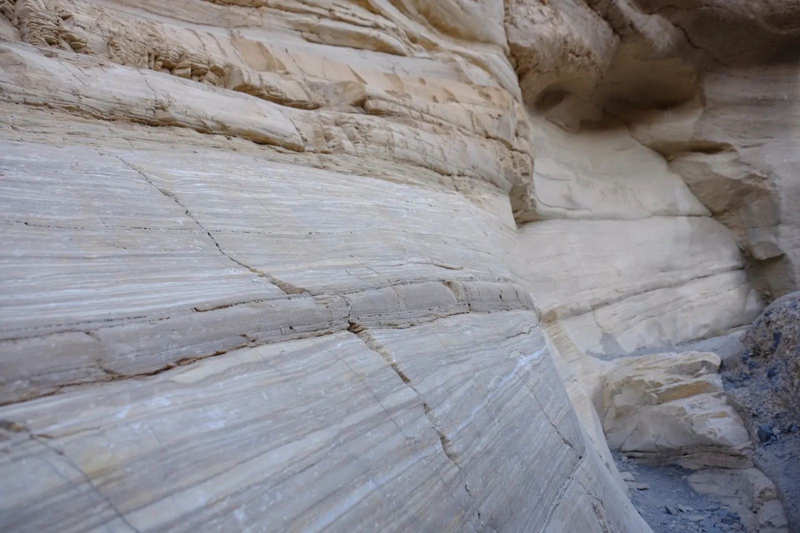

*Mosaic Canyon's polished marble. Nature's countertop.*

_Date: April 22, 2017 at 7:23:06 PM PDT_

_Location: 36.3231° N, 116.559° W_

### Mesquite Flat Sand Dunes
Nothing makes a better introduction to Death Valley than a visit to the 100-foot-high Mesquite Flat Sand Dunes which was also our last stop of the day at Death Valley.

A walk on these silky, rippled dunes will convince you that you’re someplace far from the familiar.

We walked over to the sand dunes which was very accessible from the parking lot. Abdu and PG sat on top of a small sand hill close to a Chinese Photowalk group. Koshy, Shambu Annan and I kept walking for quite a while. It was very hard to walk up to the top of the steep dunes.

I sat there for a while reflecting on all the experiences life is throwing at me. Yet again, I felt so small at the feet of mother nature.

As we go on acquiring more stuff in life, we fail to realize that everything we have is obtained from the earth. We do not create anything; we borrow everything from the earth to produce all the junk we have around us. By doing so, we deplete the natural resources of mother nature. We should be more thankful for all that are given to us in life.

We walked back to the parking lot. I removed my shoes and hung them over my shoulders. It felt great walking barefoot after a long time. Enjoyed few moments of stillness and retrospective thoughts.

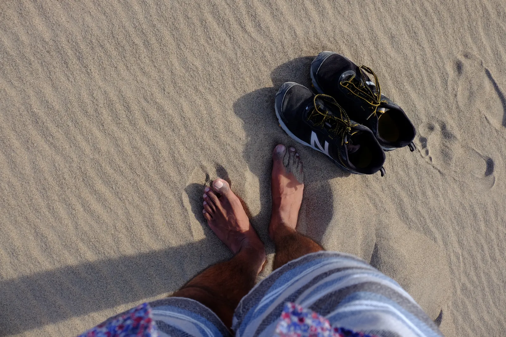

*Shoes off at the Mesquite Flat dunes. Best five minutes of the day.*

_Date: April 23, 2017 at 6:51:56 AM PDT_

_Weather: 61°F Sunny_

_Location: I-15 N, Overton, NV, United States_

### Winding up Day 1
Went (Airbnb)home, freshened up, got out to have dinner at a Japanese Curry Restaurant. Good food and good company. Came back home at 11:30 PM and called it a day.

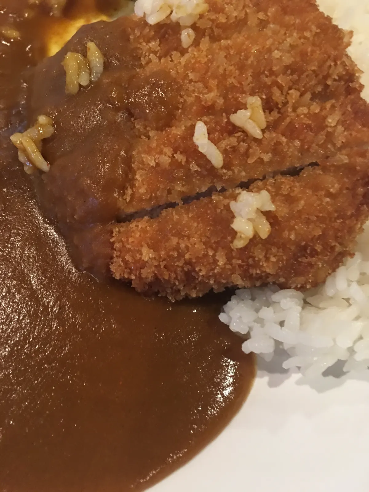

*Katsu curry: the reward for the longest day.*

Good times. Adios

## Day 2
_Date: April 23, 2017 at 6:54:38 AM PDT_

_Weather: 61°F Sunny_

_Location: I-15 N, Overton, NV, United States_

### A Day with the Hoodoos
I got up at 3:15 AM to realize that it was freezing cold inside the house. The previous night Abdu felt that it was too warm and turned the thermostat to a (modest in his words) 62 F. And Shambu Annan was sleeping on the living room couch without even a blanket. Poor thing. I woke him up and asked him to sleep in my room as there was still plenty of time for us to start the day and I wake up early anyway. After I got out of the restroom, I saw that PG was already up. The dude was watching IPL and managing his fantasy league team. I got ready, transferred all the previous day's videos to the computer.

We finally started from the house at 6. Again, behind schedule by more than an hour, credits to Abdu's and Koshy's long bathroom breaks. A quick stop at the fuel station for top up. Grabbed breakfast, a cup of hot chocolate, some snacks and water. 250miles drive to Bryce Canyon.

_Date: April 23, 2017 at 10:31:06 AM MDT_

_Location: 38.0146° N, 112.509° W_

### Behind schedule
I dozed off for a while and opened my eyes to realized that these doozies had stopped the car and were chilling outside. I had to throw a little tantrum to get them back in the car and moving. Since we're already so much behind schedule, any time wasted like this will cost us to miss a lot of great destinations planned for the day. Somebody has to keep tabs about the time. Somebody's me!

_Date: April 23, 2017 at 11:48:50 PM MDT_

_Weather: 52°F Clear_

_Location: 475 Newel Ave, Hildale, UT, United States_

### Bryce Canyon - Zion
We reached Bryce Canyon by 11:30 AM. Since it was the earth day weekend, the entrance to all major national parks was free. We took the the free national park shuttle. The shuttle driver had a good sense of humor. He seemed particularly interested in trees, especially the ones stricken by lightning. Everytime he mentioned trees, I would turn back and guffaw at PG. By this time, we all started noticing Koshy's excitement on seeing trees and his interest in photographing them. We saw some of his wild moments in Death Valley yesterday where the trees were a rare sight. He was photographing every log of trees that was lying around. PG was having fun. He finally got someone else to share the Tree Man title with.

We got down at Bryce Point.

Took some pictures at the Bryce Point, and then headed to the Inspiration point.

Wind, water and time have eroded Bryce Canyon National Park's sandstone cliffs into otherworldly characters plucked from the unconscious of a Mad Viking. Rows of humanoid pillars crosshatched by rock-strata look almost intentional but perfectly surreal. So silent, eerie and beautiful. So improbable it has to be true. A panorama of goblins, towers and fins of a color you can’t quite name welcomed us.

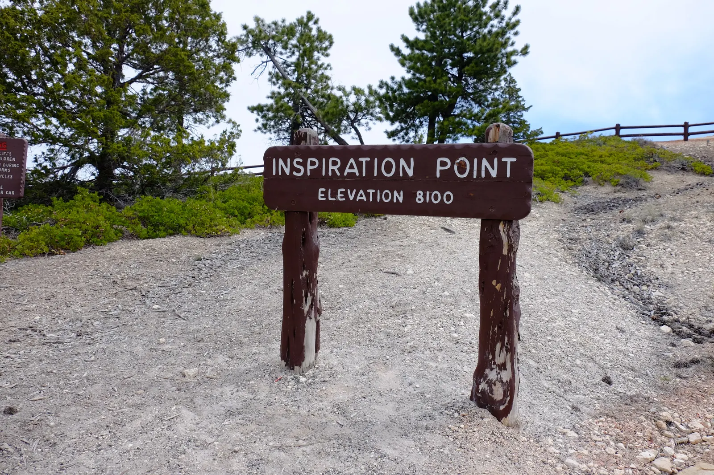

*Inspiration Point, elevation 8,100 ft.*

After getting inspired at the Inspiration Point, we headed over to Sunset Point to hike the Navajo Loop trail. As soon as we started the hike we saw the rock formation called the Thor's Hammer. Just like the name, the hoodoos shaped exactly like a massive hammer.

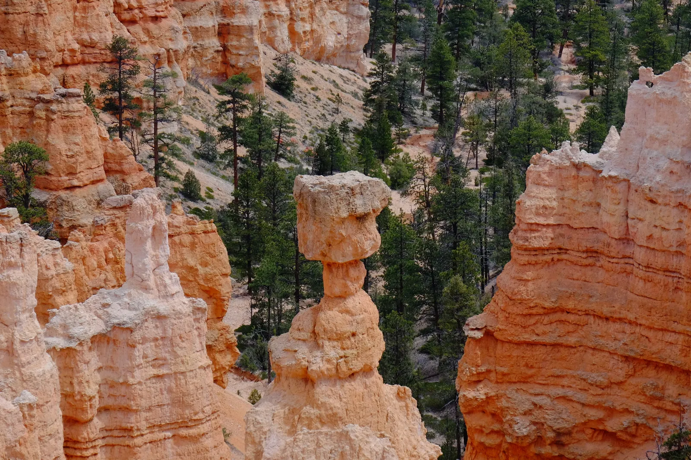

*Thor's Hammer. Yes, it really looks like that.*

We then walked along the Wall Street of the West. Tall rock formations created walls with narrow switchbacks trails in between. I literally felt as if I were walking between the skyscrapers of New York City.

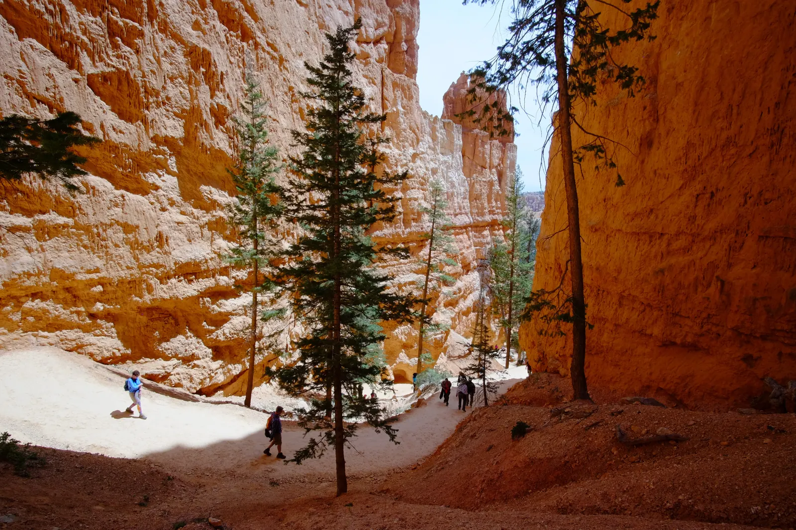

*Wall Street of the West. I felt like I was walking between New York skyscrapers.*

When we were just 0.4 miles away from the end of the loop, we realized that the trail ahead was closed due to a landslide. And the odd thing is that PG knew all along about this and didn't tell us. This also meant that we have to hike back the 2 miles with an elevation gain of more than 400 feet.

PG and Shambu Annan had to really struggle their way back, and honestly, so were the rest of us too. We had to wait every few meters for PG and Shambu to catch up.

I was constantly teasing them for being so slow. On one of their pit-stops, I saw them talking to an elderly American Couple. After 2 minutes, both of them were speeding up the trail. I had no idea how that family managed to make these mules walk so fast, so soon. PG later told me that that guy told them that "you guys are young and should be more energetic. If you don't keep moving I will call 911". No wonder how they got that sudden burst of energy!

Nobody was interested in going to the sunrise point which was supposed to be our last stop at Bryce Canyon.

The entire hike took us around 2 hours. We took a short break, went to a souvenir shop to get some touristy stuff. I bought a magnet as always.(whenever I'm traveling around the US, I collect these magnets from the places I visit) I had very little time planned for the meal breaks during the trip and thought that we would be snacking on meal replacement bars, dry fruits, and nuts for the most of the trip. I had my reasons for it. An elaborate meal would make everyone lethargic.The snacks would give enough calories for the day, and we had a very tight schedule.

But we had Abdu, who had a hunger problem. He gets hungry every now and then, and he needs real (as in cooked meal)food. If he doesn't get it, he becomes a little crazy and paranoid. He is thus called the Hungry Hog! Honestly, thanks to Abdu, we stumbled upon some really cool places to eat throughout the trip.

The next stop was at Mountain Harvest Restaurant which was run by two young "men" aged probably 7 or 9. Their parents were busy as there were some renovations going on. But the boys really did a fantastic job behind the counter. Very courteous, agile and attentive. Real impressed!

Abdu had some funny moments with them when he went to them asking for a microwave oven. The boys had no idea what Abdu wanted and after a lot of asking and re-asking questions, he explained that he just wanted to heat his coffee which got cold as it was outside for a while. He got them to heat it up and didn't really drink the coffee until after another 30 minutes.

From there, it was a straight drive to Canyon Overlook at Zion National Park. When I told everyone that it would require a mile hike up the canyon, everyone kind of sounded a little upset.

By this time, I had acquired my fair share of nicknames. I was called the Headmaster because I was very strict and anal about sticking to the schedule. I was also called Natarajan (Nata- Walking, Rajan-King) because I love walking and forces everyone to walk as much as I do.

But their discomfort about hiking didn't last too long, all thanks to the several cuties who were hiking alongside us.

And finally, the overlook. While I felt that Dante's view from yesterday was one of the most scenic views I have ever witnessed, I have to admit that this overlook is ever better.

Hands down the best view of the trip so far.

Mesmerizing canyon and roads resembling a sidewinder snake wounded up against the valley, all spotlighted by the setting sun and clouds, it looked as if it came straight out of a poem.

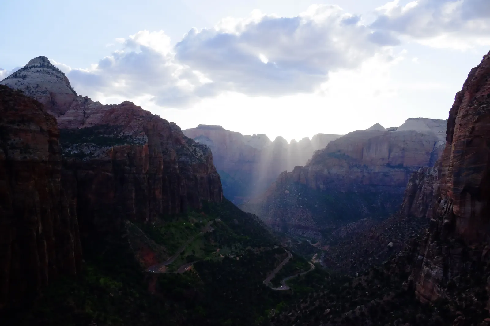

*Zion from the Canyon Overlook, the light showing off.*

PG revealed that he has vertigo issues(fear of heights) while we were up there. I knew this beforehand and had to make some adjustments to the travel plans to suit everyone's taste and preferences. Anyway, PG happily inherited the name Mr. Vertigo at that point and decided to hand over the "Tree Man" title to Koshy.

We stayed there for a little longer and drove to the park to take pictures of the watchman.

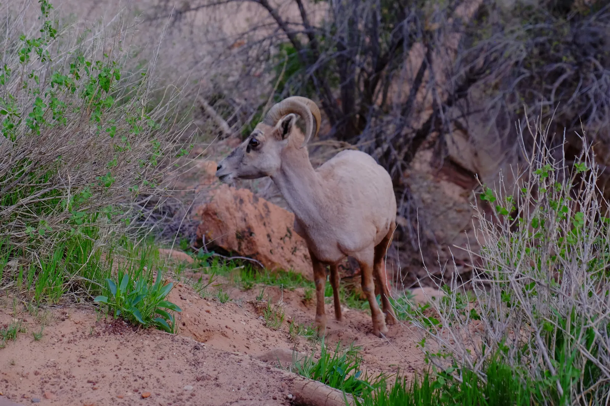

*The local with the right of way.*

The Watchman is the most photographed icon in Zion National Park for a couple of reasons. First, it is a beautiful and shapely rock mountain that happens to “face” the valley from the South and it glows at sunset. We got a great view from the bridge leading to the Visitor Center. Stood there for a while and headed out home(Airbnb again). Tonight's stay's at Hurricane UT.

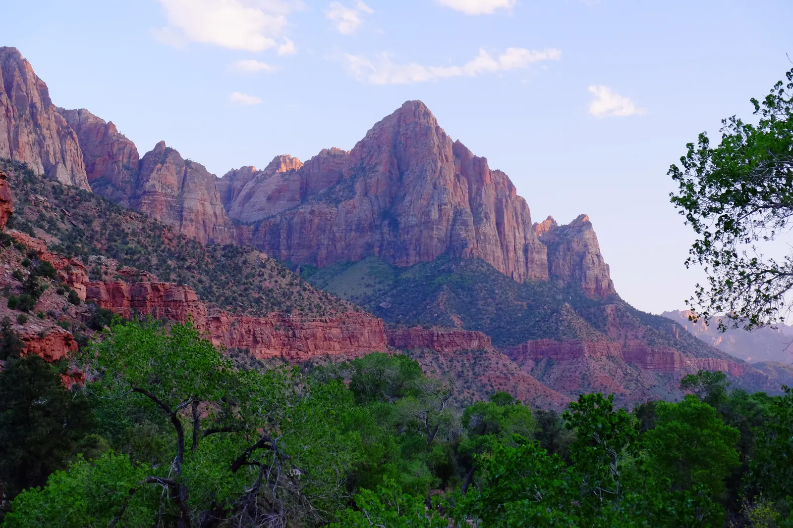

*The Watchman at sunset, from the bridge by the Visitor Center.*

We bought some ready to cook noodles and reached Mindy's house. Mindy was very courteous. The house is a little dated, but was really neat and stocked with books, groceries and everything else the guests needed. We watched Netflix and had our dinner. Since there was very little light pollution around and the there was a cloudless clear sky, I set up the camera to do some astrophotography to create a star trail photo.

Now wound up in the bed writing this. Have to wake up early. Miles to go and places to reach. Adios.

_Date: April 24, 2017 at 5:56:53 AM MDT_

_Weather: 39°F Clear_

_Location: 20 E Utah Ave, Hildale, UT, United States_

## Day 3
I woke up at 3 AM, took some pictures of the stars and the Milky Way. Everyone got ready and we started at 6 AM(5 AM was the planned time). Today's agenda is to visit Angel's Landing and the Observation Point at Zion and then drive to Valley of Fire for the rest of the day's fun.

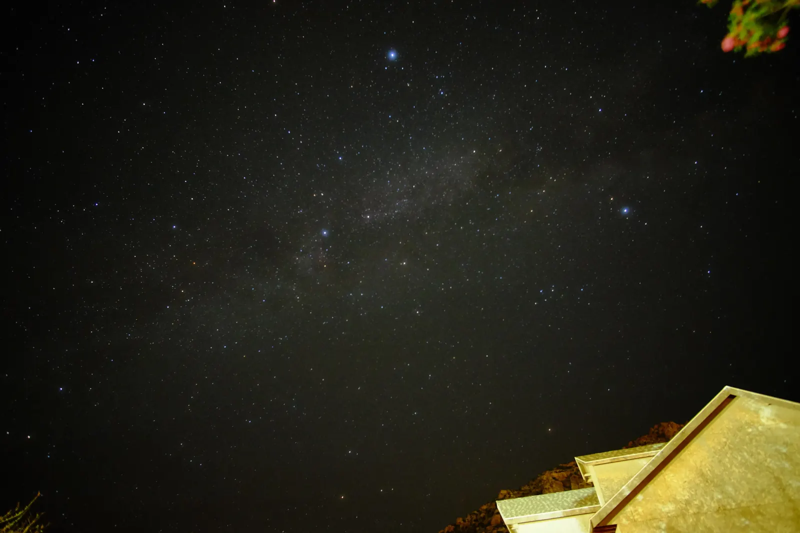

*3 AM at the Hildale Airbnb: the Milky Way, no light pollution.*

_Date: April 24, 2017 at 7:45:16 AM MDT_

_Weather: 70°F Nearby Blowing Dust_

_Location: 37.2707° N, 112.938° W_

### The A\_\_hole
We all checked out of Mindy's place and started driving in the direction of Zion National Park Visitor's Center when we encountered a little road rash with a biker who is a complete asshole. We were in a hurry, and he was not letting us pass by. He was purposefully slowing down in fast sections of the road, and if we happen to overtake him, he will speed up and pass us again, remaining in our front for a while. That jackass also showed us a middle finger at the end of it! We took it cool and moved on.

_Date: April 24, 2017 at 10:33:41 AM PDT_

_Weather: 72°F Sunny_

_Location: 4365 N Moapa Valley Blvd, Overton, NV, United States_

### On the way to Valley of Fire
This is where my tour-planning-ego got a real hit. We drove to Zion only to realize that we couldn't drive the scenic drive because the route was reserved for shuttles and cars with Red tags(given by the Park Lodges). We took the shuttle went as far as Grotto Point. That's when I realized that the observation point was an 8-mile hike.

As a plan B, we took the short 1-mile hike to the weeping rocks. Took some pictures. Some deer fawns were walking beside us.

We walked back to the base. Time for another one of my #headstandaroundtheworld pose.

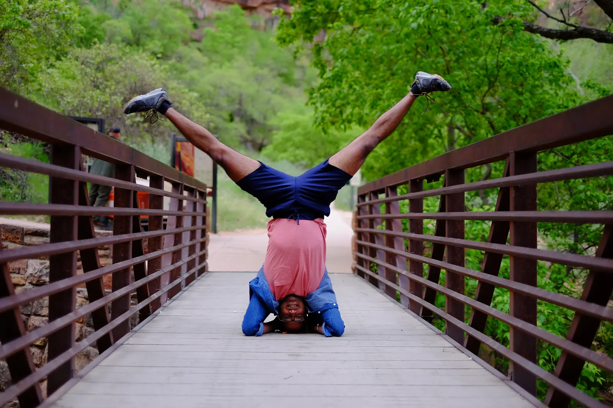

*Headstand at Zion. Seven AM, still no regrets.*

Shambhu Annan got a new nickname: "homeless boy" because of an old gray hoodie which he wears everywhere. Did I already tell you about Koshy's new name Tree Man aka"Mara Koshy" thanks to his newfound love of trees? I think I did.

_Date: April 24, 2017 at 3:39:22 PM PDT_

_Weather: 84°F Sunny_

_Location: I-15 S, Overton, NV, United States_

### End of tour de wild west
The way to the Valley of Fire was scenic as expected with long straight and deserted highways resembling racetracks. Since it was a Monday. There was very little traffic on the road. Abdu was driving. We stopped at a really nice breakfast place in Hurricane, UT.

Everyone asked me, "the headmaster" to give them their three-day "test scores". I gave PG an 8 because he did not underdeliver. Met my expectations. Koshy got a 7 as he was slower than expected, but was not too bad. Abdu wrecked havoc on the schedule with this constant calls for food and bathroom breaks.Hence he got a 6. Hobo got a 6 too as we expected more rigor from him as he was an ex-athlete(now injured for almost a year). But he was as lazy as a granny.

The rest of the drive was fun until we suddenly saw a sudden flash of Blue and Red lights. Cops! Of course, we were speeding. Empty open highway and what would you expect? But at least when he caught us, we were only 75mph on a 55mph. The cop gave us a ticket for 70mph on a 55mph.

We, recovered from that small blow as soon as we entered the Valley of Fire. It was smoking hot, and the place was named that way for a reason. The whole place looked as if it was burning.

An overflow of golden brown and orange colors. We took some pictures of the hanging rock from the visitors center.

Then we headed to the Rainbow point.

We saw a wild bighorn sheep perched on the rocks. I decided not to go further as it might take a while to complete the trail and we were already running out of time and might have to scramble through the best destinations at the Valley of Fire. Abdu had to catch a flight at 8 pm, and he had not yet checked in. So we had to go early.

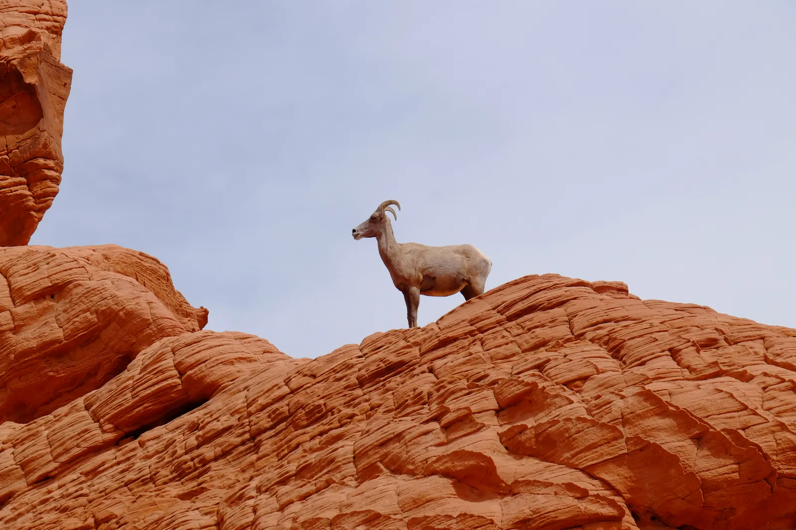

*Our 'deer' at Valley of Fire turned out to be a bighorn sheep.*

On the way back to the parking lot Hobo's hand brushed against a cactus(Julia Cactus, we got to know later) and three long thorns stuck to his finger. They had a shape like an arrow, and we couldn't pull them out as the arrow head was stuck inside.

Moments of panic followed. Shambhu Annan remained relatively calm as we rushed him to the visitors center where a park ranger took the thorns out pretty easily.

We then headed to the Fire Wave trail. It was a 20-minute drive, and the parking lot was quite empty.

Fire Wave had long remained a mystery of Valley of Fire State Park. Many people had seen the pictures, yet most people did not know the exact location of this rock formation until 2012 when the park authorities marked a trail near parking lot #3.

We parked the car and hiked the short trail to fire wave; I guess most people are still unaware of such a place. We had seen quite a crowd at the visitors center, yet we just met 4 or 5 small groups of people along the full length of the trail.

Fire Wave is truly magical. It felt as if we were in some unearthly place. The massive force of nature carved beautiful patterns on the rocks which resembled the blazing waves of a wildfire. It was such a majestic sight.

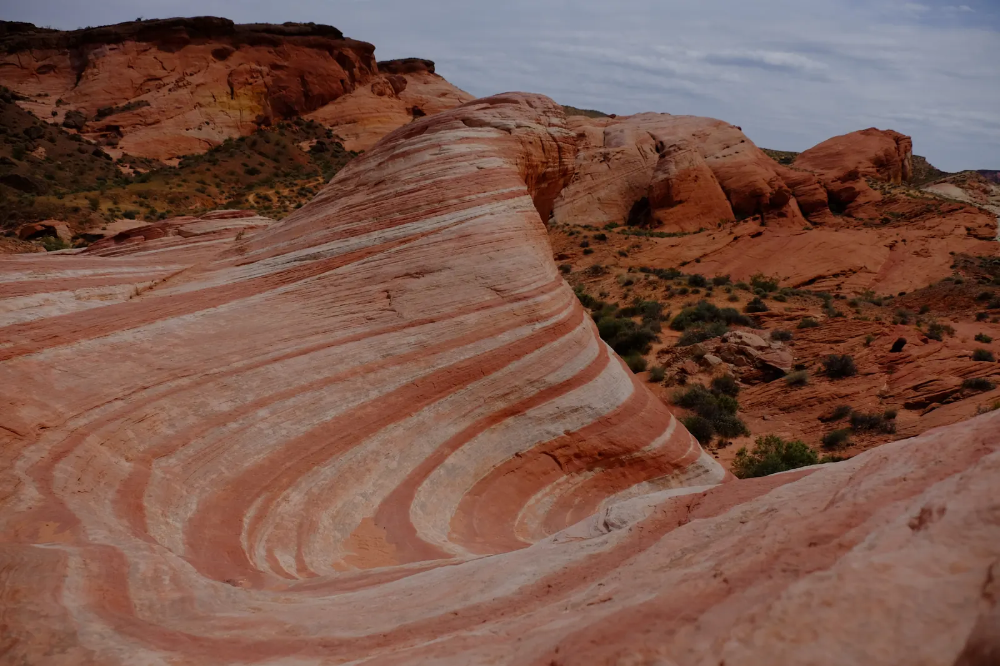

*The Fire Wave. Nature's cinnamon roll.*

As our weekend trip was coming to an end, we all sat there for a while, relaxing, enjoying the views, taking pictures and cracking jokes. When everyone thought that the trip was over and had to turn back to walk over to the parking lot, I told them that there was more. I had a little gift for them. There is a place called pink canyon right next to the Fire Wave which is still unknown to most people who visits the place. I did quite a lot of research to find the exact location of this off-the-grid rock formation. It was an old desert wash, but the water and floods polished the rocks into a mesmerizing pink slot canyon which resembled the more famous slot canyons of Utah.

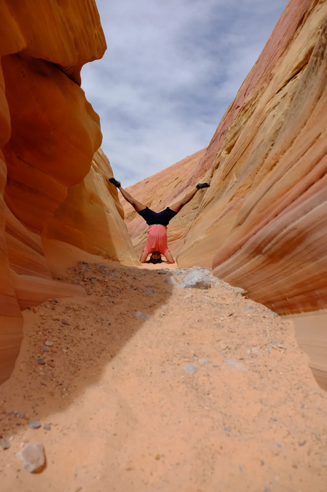

*The pink canyon I researched for weeks. Headstand obligatory.*

Lots of pictures and my #headstandaroundtheworld pose later, we headed back to the parking lot. Even though I had a couple more places in my schedule and we had time, I realized that we had reached a good saturation point.

If I force them to go(walk) to any more places it will make everyone bored and tired. So I decided to call it a day and head back to Vegas.

We had lunch at Siam Garden which is a hole in the wall Thai restaurant often touted to have the best Thai food in the state of Nevada.

Fun Fact: You can order food with spice levels as high as 36 (apparently that is the record and nobody have braved to go higher yet). I chose 2 as the spice level, and that itself was good enough for me. Good find!

_Date: April 24, 2017 at 6:25:43 PM PDT_

_Weather: 82°F Sunny_

_Location: 110 N 8th St, Las Vegas, NV, United States_

### Downtowner
After having sumptuous food from Siam Garden Thai Restaurant, Shambhu Annan made the right call of booking a cheap motel room for us all to freshen up.

We all freshened up. Abdu bid us all goodbye and took an Uber ride to the airport. Rest of us headed to Fremont St. to get a small taste of Vegas streets.

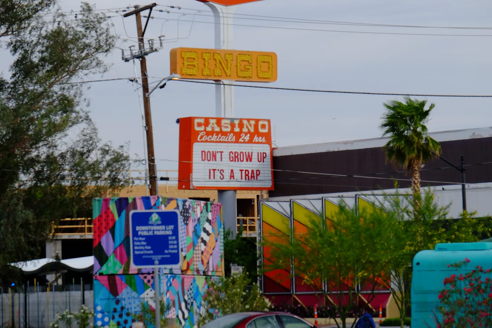

*Fremont Street's advice: "Don't grow up. It's a trap." Noted.*

_Date: April 24, 2017 at 7:42:30 PM PDT_

_Weather: 70°F Nearby Blowing Dust_

_Location: 36.1696° N, 115.141° W_

### Brownie
Our first stop at Fairmont street fair was at an old pub where PG and other folks used to visit. For good old times' sake, they decided to have a beer. I got a hot, brownie with ice cream and whipped cream.

It was humungous.

_Date: April 24, 2017 at 8:06:02 PM PDT_

_Weather: 70°F Nearby Blowing Dust_

_Location: 36.1705° N, 115.145° W_

### Walk of lights
Like I've said earlier, I have this habit of collecting souvenir magnets wherever I'm traveling. I went to a souvenir shop and picked up a magnet worth $2. PG told me that I've to pay cash if the cost is less than $10. That's when I saw a souvenir shot glass which had a small clay model of a nude lady in it. As I reached out to grasp it, I accidentally knocked over another display item which fell and broke! Now my total souvenir cost came to $15. I paid using my credit card. Enjoyed the live music and entertainment scene of Vegas for a while.

_Date: April 24, 2017 at 8:25:42 PM PDT_

_Weather: 70°F Nearby Blowing Dust_

_Location: 36.1125° N, 115.173° W_

### Bellagio
Next stop was at the ever famous Bellagio casino and hotel.

We parked at the nearby Flamingo hotel and walked over to Bellagio Hotel.

Interior of Bellagio was grand, ornated using different color combinations of flowers. They had a Japanese themed display exhibition of flowers as well which was super cool.

After roaming around the shopping area for a while, we headed outside to watch the famous musical fountain of Bellagio.

There is a show every 15 minutes each being a different song.

We stayed there for a couple of songs. I told Shambhu Annan that we should come back to Vegas again for his bachelor party as he's getting married in a couple of months!

I am not going to give more details. "What Happens in Vegas, stays in Vegas"

_Date: April 24, 2017 at 9:20:50 PM PDT_

_Weather: 70°F Nearby Blowing, Dust_

_Location: 36.1124° N, 115.173° W_

### Car rental return
After Bellagio's, we walked back to the parking lot. Got the car, parking was free as we were able to get in and out within a couple of hours. Headed out to a fuel station and topped up the gas before returning the car.

_Date: April 24, 2017 at 11:28:20 PM PDT_

_Weather: 70°F Nearby Blowing Dust_

_Location: 36.0796° N, 115.137° W_

### Car Rental Key Incident
I didn't return the car key! I realized it when we were heading out to the security gates at the airport. Nor did the guy who gave us the car return receipt ask for it. That guy from the car rental company called a while later, and I told him that I would ship back the key to them after I reached Philadelphia.

_Date: April 24, 2017 at 11:28:39 PM PDT_

_Weather: 70°F Nearby Blowing Dust_

_Location: 36.0797° N, 115.137° W_

### Tired.
Out flight to Philadelphia was on the runway, and it took a long time for it to take off. I hardly noticed it as I was snoring my way to lullaby land as soon as I found my seats. The past three days were tough on my sleep deprived over-worked brain. Time to take it easy and get a good night's sleep as I have to head to the office tomorrow.

What else to say?

Adios Amigos!
